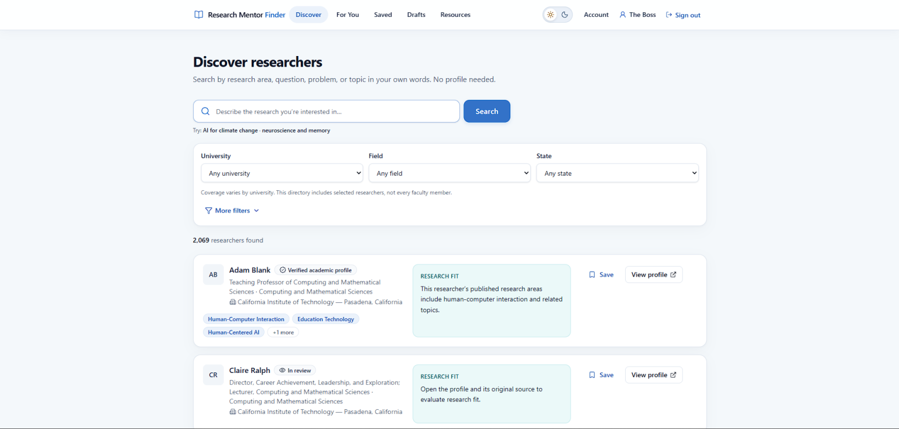

# Research Mentor Finder

**Discover university researchers who match your interests.**

Research Mentor Finder is a web application designed to help high school and college students discover university researchers whose work aligns with their academic interests.

**Live application:** https://researchmentorfinder.org

## Application Preview



## Features

- **Researcher discovery:** Search university researchers using natural-language queries.
- **Intelligent matching:** Rank results through semantic similarity when configured, with keyword-based search available as a fallback.
- **Advanced filters:** Narrow results by university, location, discipline, research field, and verification status.
- **Research fit explanations:** Understand why a researcher matches a particular query.
- **Researcher profiles:** Explore published research interests and available university profile information.
- **Saved researchers:** Organize researchers for further consideration.
- **Outreach tools:** Prepare personalized outreach drafts, with optional Gmail draft integration.
- **CSV exports:** Export research results for further analysis.
- **Demo mode:** Explore the application using fictional example researchers without connecting external services.

## Technology Stack

| Component | Technology |
|---|---|
| Frontend | Next.js 16, React 19, TypeScript |
| Styling | Tailwind CSS |
| Backend | FastAPI, Python |
| Database | SQLite |
| AI integration | OpenAI embeddings and optional AI-powered features |
| Authentication | Optional Google OAuth |

## Getting Started

### Prerequisites

- Python 3.12 (tested development environment)
- Node.js 20.9.0 or newer
- npm

### 1. Clone the repository

```bash
git clone https://github.com/CloudedCoder189/research-mentor-finder.git
cd research-mentor-finder
```

### 2. Configure the backend

Create and activate a Python virtual environment:

```powershell
py -m venv .venv
.\.venv\Scripts\Activate.ps1
pip install -r requirements.txt
```

Copy `.env.example` to `.env` if you need to configure optional services. Real API keys and credentials must never be committed.

For local demo testing, the backend can run without external service credentials.

### 3. Initialize demonstration data

The repository provides 10 fictional researcher records for testing.

```powershell
python -c "from seed_data import seed_demo_data; print(seed_demo_data())"
```

These records are fictional and are clearly labeled as demonstration data.

### 4. Start the backend

From the project root:

```powershell
python -m uvicorn api.main:app --host 127.0.0.1 --port 8000
```

Verify that the backend responds at:

http://127.0.0.1:8000/api/health

### 5. Start the frontend

Open a second terminal:

```powershell
cd frontend
npm ci
npm run dev
```

Visit:

http://localhost:3000

The frontend defaults to the backend at `http://localhost:8000`.

To use another backend address, configure `NEXT_PUBLIC_API_BASE_URL` in `frontend/.env.local`.

## AI Search

Research Mentor Finder supports two matching approaches:

**Keyword matching:** Works without external AI credentials and matches queries against published research information.

**Semantic matching:** When configured with an embedding service and indexed researcher data, semantic search helps identify conceptually related research interests.

The application can use keyword-based matching when semantic search is unavailable.

## Research Data

The full application uses researcher information collected from publicly available academic sources.

The GitHub repository excludes the production database, private account records, saved outreach information, and authentication tokens.

Developers can explore the application using the included fictional demonstration records. University scraping and data preparation tools are available in the source code for building a separate dataset.

Researcher matches do not guarantee that a professor is accepting students or offering research opportunities.

## Additional documentation

- [Official university directory sources](docs/UNIVERSITY_SOURCES.md)
- [Documentation index](docs/README.md), including archived development notes

## Privacy and Security

- Real API keys are stored outside version-controlled source code.
- Runtime databases and private user information are excluded from GitHub.
- Example environment configuration files are provided for setup.
- Gmail integration is optional and designed for creating drafts rather than automatically sending outreach emails.
- Users should verify researcher information through official university sources before contacting researchers.

## Project Structure

```text
research-mentor-finder/
├── api/               # FastAPI backend and routes
├── frontend/          # Next.js web application
├── services/          # Search, ranking, and related logic
├── scrapers/          # University data collection
├── scripts/           # Development and maintenance utilities
├── tests/             # Automated tests
├── database.py        # Database operations
├── seed_data.py       # Fictional demo records
├── requirements.txt   # Python dependencies
└── README.md          # Project documentation
```

The current application lives in `api/` and `frontend/`. Historical Streamlit
tools and snapshots are retained in [`legacy/`](legacy/README.md); its
one-time maintenance scripts should not be run against production data.

## Testing

Install the test dependencies in your active virtual environment and run the offline Python suite:

```powershell
python -m pip install -r requirements-dev.txt
python -m pytest
```

Run frontend checks from the `frontend` directory:

```powershell
npm run lint
npm run typecheck
npm run build
```

## Congressional App Challenge

Research Mentor Finder was submitted to the **2026 Congressional App Challenge** as a student-developed application focused on making university research discovery more accessible.

## License

This project is licensed under the MIT License.
See the [LICENSE](LICENSE) file for details.

Copyright (c) 2026 Sai Nirmith Indukuri.